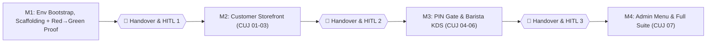

# ☕ Courtyard Coffee — Implementation Plan

This plan bridges the [Final Specification (`spec_courtyard_coffee.md`)](./spec_courtyard_coffee.md) and the [Formalized Agentic CUJ & Live Testing Plan (`live_testing_plan.md`)](./live_testing_plan.md) into an actionable build sequence inside `/Users/joshuacooper/Documents/code/courtyard-coffee`.

---

## 1. System Architecture & Hardened Contracts

1. **Workspace & Sandbox Runtime Configuration**:
   - **Location**: `/Users/joshuacooper/Documents/code/courtyard-coffee`.
   - **Node / npm Bootstrap**: Install Node via `/opt/homebrew/bin/brew install node` so `/opt/homebrew/bin/{node,npm,npx}` are available inside the default sandbox `PATH`.
   - **Sandbox-Safe `.npmrc` & `.git/config`**:
     - Repo-level `.npmrc` sets `cache=/tmp/npm-cache` and `logs-dir=/tmp/npm-logs` so `npm test`, `npm run db:seed`, and `npm run dev` run inside Standard Sandbox Mode (`BypassSandbox: false`).
     - Repo-local `.git/config` sets `user.name = "Courtyard Coffee Bot"` and `user.email = "bot@courtyard-coffee.local"` immediately after `git init -b main` so sandboxed `git commit` calls succeed.
2. **Single-Command Local Server (`npm run dev` on strict port `3000`)**:
   - **Vite + React 18 + TypeScript + Tailwind CSS**, configured with `server: { port: 3000, strictPort: true, host: '127.0.0.1' }`.
   - A unified raw HTTP dispatcher (`api/handler.ts`) uses Node `IncomingMessage` / `ServerResponse` stream helpers (`readJsonBody(req)`, `sendJson(res, status, payload)`) and prefix/regex routing so the exact same code runs inside Vite's `server.middlewares.use('/api', ...)` and Vercel Serverless entrypoints.
3. **Synchronous SQLite Repository (`api/db.ts`) & Concurrency Protection**:
   - Wraps synchronous SQLite (`better-sqlite3` with built-in Node `node:sqlite` `DatabaseSync` support) over `./db/data.db`, maintaining full binary compatibility with `/usr/bin/sqlite3 ./db/data.db` CLI queries.
   - **API Routes**:
     - `GET /api/store` — Reads the single-row `StoreStateDocument` JSON from `store_state`.
     - `PUT /api/store` — Atomically merges updates into `store_state` inside a transaction while enforcing **monotonic `nextOrderNumber` protection**: `Math.max(currentState.nextOrderNumber, maxOrderRowNumber + 1, incoming.nextOrderNumber ?? 101)`. Admin KDS/Menu updates (`CUJ-06`, `CUJ-07`) can never overwrite `nextOrderNumber` with a stale client value.
     - `POST /api/order` — Runs an atomic transaction that reads `nextOrderNumber`, inserts the immutable `OrderTicket` into `orders`, increments `nextOrderNumber` in `store_state`, and returns the created `OrderTicket` (`201 Created`).
     - `GET /api/orders` — Returns all rows from `orders` ordered by `number ASC` (polled every `2000ms` by `/admin/kds`; the customer storefront `/` never polls).
     - `PATCH /api/orders/:id` — Updates `isNotified` and/or `isDone` on a specific ticket in `orders` (`CUJ-05` 2-tap workflow).
     - `POST /api/orders/reset` — Shift-reset action on `/admin/kds` (clears `orders` table and resets `nextOrderNumber` to `101`).
4. **Pure-TS QR PNG Encoder & Deterministic Test Polyfills**:
   - **`src/utils/qr.ts` (`generateQrDataUrl`)**: Generates a valid QR matrix and encodes it directly into an uncompressed `240×240` binary PNG (`Uint8Array` with PNG signature + `IHDR` + zlib `IDAT` + `IEND` → `data:image/png;base64,...`) in pure TypeScript. This works in both Node/Vitest (`jsdom`) and real Chrome (`img.complete === true && img.naturalWidth === 240`, `CUJ-03`).
   - **`src/__tests__/setup.ts`**: Provides deterministic JSDOM polyfills for `Image.onload` (parsing PNG `IHDR` dimensions), `HTMLCanvasElement` (`getContext('2d')` and `toDataURL('image/jpeg')`), and `window.AudioContext` so Vitest unit tests for `compressImageFileToDataUrl()` and `playGentleChime()` execute deterministically without hanging.
5. **CUJ UI & Telemetry Contracts**:
   - **Cart Keying & Inline Stepper (`CUJ-01`, `CUJ-02`)**: Cart lines are keyed by `${item.id}::${sortedTagIds.join(',')}::${note.trim()}`. Untagged items (`item.tagIds.length === 0`) transform their **+ הוסף** button into an inline `- [ qty ] +` stepper when `qty > 0`. Tagged items (`item.tagIds.length > 0`) always open `TagBottomSheet`.
   - **Out-of-Stock Tag Visibility & Closed-Store Inspection (`CUJ-02`, `CUJ-06`)**: `TagBottomSheet.tsx` renders all attached `GlobalOptionTag`s; tags with `!tag.inStock` render with `disabled={true}`, struck-through styling, and `(אזל)`. When `store.isOpen === false`, the Closed Banner is displayed and order submission/instant-add are disabled, while clicking **+ הוסף** on an in-stock tagged item (e.g., Cappuccino in `CUJ-06`) still opens `TagBottomSheet` in read-only/closed mode so customers and `CUJ-06` can verify unavailable tags (`"חלב שיבולת שועל"`).
   - **KDS Chime & WhatsApp Telemetry (`CUJ-05`)**:
     - `playGentleChime()` unconditionally increments `window.__chimeCount = (window.__chimeCount ?? 0) + 1` before invoking Web Audio synthesis inside a safe `try / catch`. `KDS.tsx` tracks `seenOrderIdsRef` and exposes `window.__resetKdsSeenOrders()` so `CUJ-05` can arm `window.__chimeCount = 0` and deterministically observe the chime on the next poll cycle.
     - Clicking **Tap 1: "Notify on WhatsApp"** sets `window.__lastWindowOpenUrl = url`, calls `window.open(url, '_blank')`, and sends `PATCH /api/orders/:id` with `{ isNotified: true }`.
   - **Immediate KDS Closed-Note Persistence (`CUJ-06`)**: Editing the Hebrew closed-note input on `/admin/kds` persists via `PUT /api/store` automatically (`onChange` debounce + `onBlur` flush) without requiring a separate save button click.
   - **Photo Album & Admin Spreadsheet (`CUJ-07`)**: `AdminMenu.tsx` supports entering or editing a photo's label either before or after file selection, binds Menu Item photo `<select>` options as `<option value={albumItem.url}>{albumItem.label}</option>`, shares live reactive state across Photo Album / Global Tags / Menu Items tables, and provides an explicit **"Save Changes"** button (`PUT /api/store`).
   - **Clipboard Resilience (`CUJ-03`, `CUJ-05`)**: Copy buttons wrap `navigator.clipboard.writeText(text)` in `try / catch` with a `<textarea>` `execCommand('copy')` fallback, record `window.__lastCopiedText = text`, and immediately transition button state to `"הועתק! ✓"` / `"Copied! ✓"`.

---

## 2. Repository Layout

```text
/Users/joshuacooper/Documents/code/courtyard-coffee/
├── package.json
├── .npmrc                       # cache=/tmp/npm-cache, logs-dir=/tmp/npm-logs (sandbox-safe)
├── .gitignore                   # node_modules/, dist/, .env.local, db/*.db*
├── tsconfig.json
├── vite.config.ts               # strictPort: 3000 + mounts /api dispatcher + Vitest config
├── tailwind.config.js           # Garden Courtyard palette & RTL helpers
├── postcss.config.js
├── index.html
├── .env.local                   # DB_PATH=./db/data.db, DEFAULT_ADMIN_PIN=1234, DEFAULT_BIT_PHONE=050-0000000
├── db/
│   └── data.db                  # SQLite database file (created/seeded by scripts/seed.ts)
├── scripts/
│   └── seed.ts                  # Deterministic reset & seed script (`npm run db:seed`)
├── api/                         # Shared Node/Vercel HTTP & SQLite layer
│   ├── db.ts                    # Synchronous SQLite repository & atomic transactions
│   ├── handler.ts               # Unified raw HTTP router (GET/PUT /api/store, POST /api/order, GET/PATCH/POST /api/orders*)
│   ├── store.ts                 # Vercel entrypoint re-exporting handler
│   ├── order.ts                 # Vercel entrypoint re-exporting handler
│   └── orders.ts                # Vercel entrypoint re-exporting handler
└── src/
    ├── main.tsx
    ├── App.tsx                  # React Router (/, /admin/kds, /admin/menu)
    ├── index.css                # Garden Courtyard CSS variables & base styles
    ├── types.ts                 # StoreStateDocument, PhotoAlbumItem, GlobalOptionTag, MenuItem, OrderTicket, OrderLineSnapshot
    ├── context/
    │   └── StoreContext.tsx     # Store state loading, cart management, admin update helpers
    ├── components/
    │   ├── PinGateModal.tsx     # 4-digit PIN gate for /admin/* with localStorage persistence & error shake
    │   ├── CustomerHeader.tsx   # Shop title ("קפה בחצר") + dynamic Open/Closed banner
    │   ├── MenuItemCard.tsx     # Photo, Hebrew title/desc, price, instant-add inline stepper OR bottom-sheet trigger
    │   ├── TagBottomSheet.tsx   # RTL customization sheet (all item tags with disabled state for !inStock + note input)
    │   ├── StickyCartBar.tsx    # Bottom floating summary bar
    │   ├── CheckoutSheet.tsx    # Customer name + phone form + order submit
    │   └── StaticReceipt.tsx    # Order # display, items summary, 240x240 Bit QR , Copy Phone button
    ├── routes/
    │   ├── Customer.tsx         # "/" — Hebrew RTL storefront & receipt flow
    │   ├── KDS.tsx              # "/admin/kds" — English LTR Barista KDS
    │   └── AdminMenu.tsx        # "/admin/menu" — English LTR Admin Spreadsheet & Photo Album
    ├── utils/
    │   ├── chime.ts             # playGentleChime() Web Audio synthesizer + window.__chimeCount telemetry
    │   ├── image.ts             # compressImageFileToDataUrl() 400x400 center-crop JPEG compressor
    │   ├── wa.ts                # formatWaPhone() + buildHebrewWhatsAppUrl()
    │   └── qr.ts                # generateQrDataUrl() -> pure-TS 240x240 PNG Data URL
    └── __tests__/
        ├── setup.ts             # Deterministic JSDOM polyfills for Image, Canvas, AudioContext, Clipboard
        ├── utils.test.ts        # Unit tests for SQLite repo/seed, WA builder, QR PNG binary, image crop, chime
        └── routes.test.tsx      # Component/integration tests for Customer, KDS, AdminMenu, and PIN gate
```

---

## 3. Data Contracts & Seed State (`scripts/seed.ts`)

### 3.1 SQLite Tables (`api/db.ts`)

```sql
CREATE TABLE IF NOT EXISTS store_state (
  id INTEGER PRIMARY KEY CHECK (id = 1),
  data TEXT NOT NULL
);

CREATE TABLE IF NOT EXISTS orders (
  id TEXT PRIMARY KEY,
  number INTEGER NOT NULL,
  customerName TEXT NOT NULL,
  customerPhone TEXT NOT NULL,
  createdAt TEXT NOT NULL,
  total REAL NOT NULL,
  isNotified INTEGER NOT NULL DEFAULT 0,
  isDone INTEGER NOT NULL DEFAULT 0,
  items TEXT NOT NULL
);
```

### 3.2 Canonical Seed Document (`npm run db:seed`)

Matches [`live_testing_plan.md`](./live_testing_plan.md) verbatim:
- `isOpen`: `true`
- `closedNoteHe`: `"סגור כעת, נשוב בקרוב"`
- `bitPhone`: `"050-0000000"`
- `adminPin`: `"1234"`
- `nextOrderNumber`: `101`
- `photoAlbum`:
  - `photo-cappuccino` (`label: "Cappuccino"`, embedded `400×400` warm latte-art data URL)
  - `photo-croissant` (`label: "Butter Croissant"`, embedded `400×400` golden pastry data URL)
- `globalTags`:
  - `{ id: "tag-oat", nameEn: "Oat Milk", nameHe: "חלב שיבולת שועל", price: 2, inStock: true }`
  - `{ id: "tag-decaf", nameEn: "Decaf", nameHe: "נטול קפאין", price: 0, inStock: true }`
  - `{ id: "tag-syrup", nameEn: "Vanilla Syrup", nameHe: "סירופ וניל", price: 3, inStock: false }`
- `menuItems`:
  - `{ id: "item-cappuccino", category: "Coffee", nameEn: "Cappuccino", nameHe: "קפוצ׳ינו", descHe: "אספרסו כפול עם חלב מוקצף בקלילות", price: 14, inStock: true, photo: "<photo-cappuccino-url>", tagIds: ["tag-oat", "tag-decaf", "tag-syrup"] }`
  - `{ id: "item-croissant", category: "Pastry", nameEn: "Butter Croissant", nameHe: "קרואסון חמאה", descHe: "מאפה צרפתי פריך בעבודת יד", price: 12, inStock: true, photo: "<photo-croissant-url>", tagIds: [] }`

---

## 4. Design System (*Garden Courtyard*)

Defined in `src/index.css` and `tailwind.config.js`:

| Token | CSS Variable | Hex | Usage |
|---|---|---|---|
| Background Primary | `--bg-courtyard` | `#FAF6F0` | Warm limestone/cream page background |
| Surface Card | `--bg-card` | `#FFFFFF` | Menu cards, KDS tickets, modals |
| Surface Subtle | `--bg-subtle` | `#F2ECE1` | Tag pills, table headers, input backgrounds |
| Brand Primary | `--color-sage` | `#3F624D` | Primary CTAs, selected pills, open status badge |
| Brand Secondary | `--color-terracotta` | `#C86D51` | Accent badges, sticky cart highlights, steppers |
| Text Primary | `--text-espresso` | `#261C18` | Headings, item titles, prices |
| Text Secondary | `--text-stone` | `#6E625C` | Descriptions, metadata |
| Status Danger / 86 | `--color-danger` | `#B84A39` | Closed banner, Quick-86 struck-through chips, PIN error |

---

## 5. Context Preservation: Subagent Isolation + Milestone Handovers

### 5.1 Subagent Role Architecture (`define_subagent` / `invoke_subagent`)
The main agent acts strictly as the **Lead Orchestrator** and delegates heavy execution to two specialized subagent types:
1. **`tdd-builder` (`EnableWriteTools: true`, `EnableMCPTools: false`)**:
   - Scaffolds files, writes **RED** failing unit/component tests, captures the failure output, commits & tags `m<N>-red`, implements the **GREEN** code, runs `npm run db:seed` & `npm test`, and commits & tags `m<N>-green`.
   - Absorbs all compiler/test logs in its isolated subagent context (`conversation://<id>`) and returns a concise Red → Green report and file links.
2. **`cuj-verifier` (`EnableWriteTools: true`, `EnableMCPTools: true`)**:
   - Manages the local dev server on port `3000`, runs `npm run db:seed` and `/usr/bin/sqlite3` verification queries, drives Chrome DevTools MCP (`navigate_page`, `take_snapshot`, `click`, `fill`, `evaluate_script`, `take_screenshot`), and visually inspects every PNG via `read_file`.
   - Absorbs all large DOM snapshots and multi-image inspections in its own context window, returning a structured CUJ verification matrix and saved screenshot paths in `<artifactDir>/scratch/screenshots/`.

### 5.2 Git Red/Green Commit & Tagging Protocol (`git init -b main`)
Every milestone produces two atomic, auditable Git commits and tags inside `/Users/joshuacooper/Documents/code/courtyard-coffee`:
1. **RED Commit & Tag (`m<N>-red`)**: `test(m<N>): add failing assertions [RED]` — commits the newly written tests + unimplemented stubs so `git checkout m<N>-red && npm test` reproduces the exact failing state at any time.
2. **GREEN Commit & Tag (`m<N>-green`)**: `feat(m<N>): implement milestone <N> [GREEN]` — commits the implementation that turns the test suite and live CUJs green (`git diff m<N>-red..m<N>-green` shows the exact implementation delta).

### 5.3 Milestone Handover Artifact + HITL Gate (`HANDOVER.md`)
At the end of **every** milestone (`M1` through `M4`), before pausing for human review:
1. We update `/Users/joshuacooper/Documents/code/courtyard-coffee/HANDOVER.md` (mirrored to `<artifactDir>/handover.md`) containing:
   - **Git Commit & Tag State**: Commit SHAs for `m<N>-red` and `m<N>-green`, `git diff --stat`, and seed command.
   - **Red → Green Evidence**: Exact summary of failing-then-passing test suites and links to the `tdd-builder` and `cuj-verifier` subagent transcripts (`conversation://<id>`).
   - **Verified CUJs & Screenshots**: Paths to inspected screenshots and verified invariants.
   - **Next Milestone Entry Contract**: Self-contained instructions and file pointers required to start `Milestone N+1`.
2. **HITL Checkpoint**: We pause at the end of each milestone so you can review and approve before the next milestone begins.

---

## 6. TDD Execution Milestones & HITL Checkpoints



### Milestone 1: Environment Bootstrap, Scaffolding, Red → Green Harness Proof & HITL Checkpoint 1
1. **Step 0 — Environment Bootstrap**:
   - Install Node in Homebrew (`/opt/homebrew/bin/brew install node` with `BypassSandbox: true` if not present) so `/opt/homebrew/bin/{node,npm,npx}` are available inside the sandbox.
2. **`tdd-builder` — Scaffold & Phase 1A (RED → `m1-red`)**:
   - Initialize `/Users/joshuacooper/Documents/code/courtyard-coffee` (`git init -b main`, local git identity, `.npmrc` with `/tmp/npm-cache`, `package.json`, Vite, React, TypeScript, Tailwind CSS, Vitest + `@testing-library/react`, `src/__tests__/setup.ts`) with unimplemented stubs for `api/db.ts`, `src/utils/{wa,qr,chime,image}.ts`, and route shells (`/`, `/admin/kds`, `/admin/menu`).
   - Write assertions in `src/__tests__/utils.test.ts` and `src/__tests__/routes.test.tsx` (SQLite seed invariants + monotonic `nextOrderNumber`, `formatWaPhone`, `buildHebrewWhatsAppUrl`, `generateQrDataUrl` 240×240 PNG header check, RTL storefront header `"קפה בחצר"`, and `/admin/*` PIN gate).
   - Run `npm test`, capture the **RED (failing)** output, and commit + tag **`m1-red`**.
3. **`tdd-builder` — Phase 1B (GREEN → `m1-green`)**:
   - Implement `api/db.ts`, `api/handler.ts`, `scripts/seed.ts` (`npm run db:seed`), `src/utils/*`, minimal route skeletons, and `PinGateModal`.
   - Run `npm run db:seed` and `npm test` to prove all assertions transition **RED → GREEN**, and commit + tag **`m1-green`**.
4. **`cuj-verifier` — Live Browser Smoke & Red → Green Proof**:
   - Start `npm run dev` on `http://127.0.0.1:3000`, verify `/`, `/admin/kds`, and `/admin/menu` in Chrome (`take_screenshot` → `read_file`), and demonstrate a live browser Red → Green DOM assertion.
5. **🛑 Handover 1 & HITL Checkpoint**:
   - Write `HANDOVER.md` + `<artifactDir>/handover.md`, present the Red → Green logs and screenshots, and **pause for your approval**.

### Milestone 2: Customer Storefront & Checkout Flow (`/` — `CUJ-01`, `CUJ-02`, `CUJ-03`)
1. **`tdd-builder` (`m2-red` → `m2-green`)**:
   - Write failing tests for instant-add inline stepper (`CUJ-01`), tagged bottom-sheet customization & disabled out-of-stock tag pills (`CUJ-02`), `POST /api/order` transaction, static receipt, and Bit QR image (`CUJ-03`); commit & tag **`m2-red`**.
   - Implement `CustomerHeader`, `MenuItemCard`, `TagBottomSheet`, `StickyCartBar`, `CheckoutSheet`, and `StaticReceipt` (enforcing `GET /api/store` only on initial load and post-checkout, zero polling); verify tests pass and commit & tag **`m2-green`**.
2. **`cuj-verifier` (Live Browser Vision Check)**:
   - Execute `CUJ-01`, `CUJ-02`, and `CUJ-03` on a `390×844` mobile viewport, capture all 7 checkpoint screenshots into `<artifactDir>/scratch/screenshots/`, and inspect every screenshot with `read_file`.
3. **🛑 Handover 2 & HITL Checkpoint**:
   - Update `HANDOVER.md` with M2 artifacts/transcripts and pause for review.

### Milestone 3: Admin 4-Digit PIN Gate & Barista KDS (`/admin/kds` — `CUJ-04`, `CUJ-05`, `CUJ-06`)
1. **`tdd-builder` (`m3-red` → `m3-green`)**:
   - Write failing tests for PIN lockout/persistence (`CUJ-04`), KDS ticket polling + `playGentleChime()` + 2-tap `Notify on WhatsApp` → `Done / Pick-up` lifecycle (`CUJ-05`), and Quick-86 stock toggling + immediate closed-note persistence + closed-store tag inspection (`CUJ-06`); commit & tag **`m3-red`**.
   - Implement full `/admin/kds` (`dir="ltr"`) including Open/Close switch, Shift Reset, auto-persisting Hebrew closed-note editor, Quick-86 strip, Active Tickets Grid, and Completed Drawer; verify tests pass and commit & tag **`m3-green`**.
2. **`cuj-verifier` (Live Browser Vision Check)**:
   - Execute `CUJ-04`, `CUJ-05`, and `CUJ-06` on desktop (`1280×800`) and mobile (`390×844`), capture all 8 checkpoint screenshots, and inspect every screenshot with `read_file`.
3. **🛑 Handover 3 & HITL Checkpoint**:
   - Update `HANDOVER.md` with M3 artifacts/transcripts and pause for review.

### Milestone 4: Admin Spreadsheet (`/admin/menu` — `CUJ-07`) & Final End-to-End Regression
1. **`tdd-builder` (`m4-red` → `m4-green`)**:
   - Write failing tests for `400×400` JPEG image compression (`compressImageFileToDataUrl`), Store JSON byte-size inspector, and inline CRUD + Save Changes for Photo Album, Global Tags, and Menu Items (`CUJ-07`); commit & tag **`m4-red`**.
   - Implement `/admin/menu` (`dir="ltr"`) with Photo Album Manager, Global Tags table, and Menu Items table; verify tests pass and commit & tag **`m4-green`**.
2. **`cuj-verifier` (Live Browser Vision Check & Full Regression)**:
   - Generate `<artifactDir>/scratch/test_upload_1000x800.png`, execute `CUJ-07`, inspect `cuj07_admin_spreadsheet.png` and `cuj07_customer_new_item.png` via `read_file`, and run the full unit + 7-CUJ regression suite.
3. **Final Handover & Walkthrough**:
   - Write `README.md`, finalize `HANDOVER.md`, and present the complete walkthrough artifact embedding all inspected CUJ screenshots.
