# ☕ Courtyard Coffee (`קפה בחצר`) — Final Walkthrough (`M1`–`M4`, `CUJ-01`–`CUJ-07`)

> [!IMPORTANT]
> **All 4 Milestones & All 7 Critical User Journeys Complete**
> Courtyard Coffee is fully implemented, verified end-to-end in headless Google Chrome via WebSocket CDP ([`scripts/cdp_harness.py`](../scripts/cdp_harness.py)), and backed by 17 passing unit, route, and static contract tests ([`tests/test_routes.py`](../tests/test_routes.py), [`tests/test_utils.py`](../tests/test_utils.py)).

---

## 1. End-to-End Visual Walkthrough Across All 7 CUJs

### A. Milestone 4 (`CUJ-07`): Admin Spreadsheet & Photo Album Manager (`/admin/menu` → `/`)

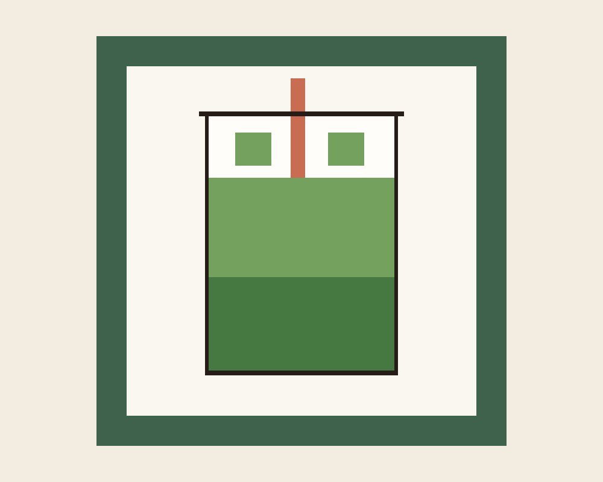

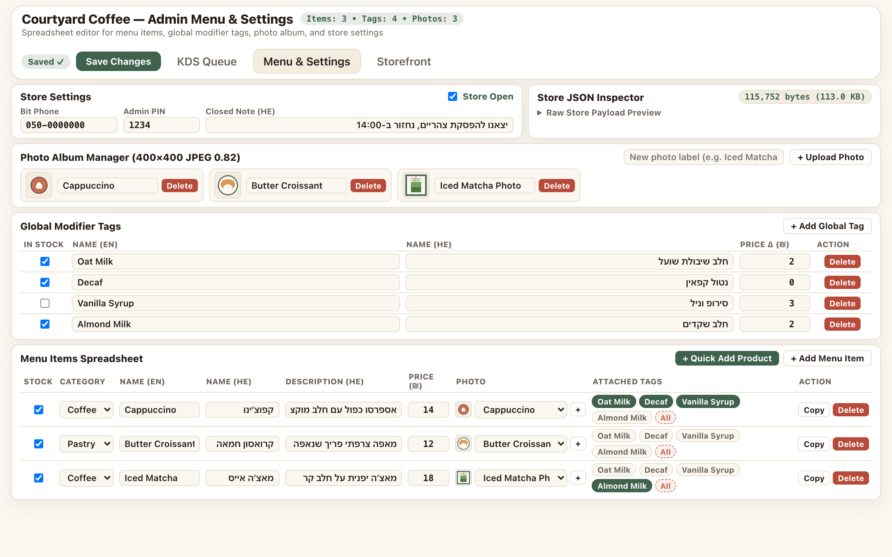

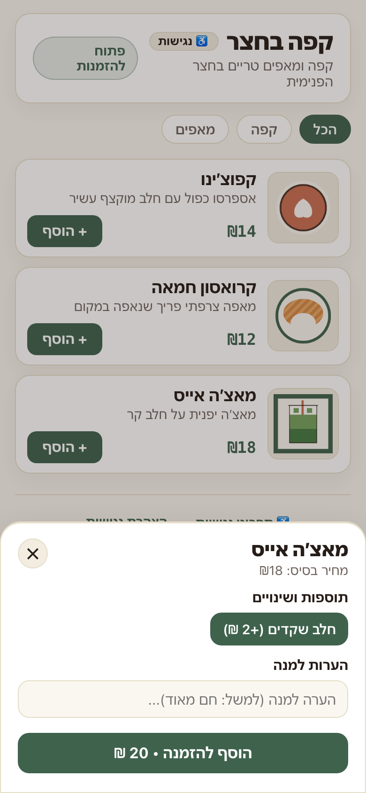

- **Store Settings & Live JSON Inspector** ([`src/routes/AdminMenu.js`](../src/routes/AdminMenu.js)):
  - Displays live serialized payload size (`new Blob([JSON.stringify(store)]).size` → `"115,749 bytes (113.0 KB)"`, `byteBadgeMatchesBlobSize: true`), collapsible raw JSON preview (`[data-testid="json-raw-preview"]`), editable Store Settings (`isOpen`, `bitPhone`, `adminPin`, `closedNoteHe`), dirty/saved status indicator (`"Unsaved changes"` → `"Saved ✓"`), and **Save Changes** button (`PUT /api/store`).
  - Fits cleanly on a `1280×800` desktop viewport (`adminViewBottomPx === 715 <= 800`, `fitsIn800pxViewport: true`).
- **Photo Album Manager (`400×400` JPEG `0.82` Compression)**:
  - Uploaded [`test_upload_1000x800.png`](../screenshots/test_upload_1000x800.png) (`1000×800` PNG, `13,273` bytes) with label `"Iced Matcha Photo"` via CDP `DOM.setFileInputFiles`.
  - [`compressImageFileToDataUrl()`](../src/utils/image.js) center-cropped and compressed it into a `data:image/jpeg;base64,...` data URL (`11,947` chars) with `naturalWidth === 400` and `naturalHeight === 400`.
- **Global Modifier Tags & Menu Items Spreadsheets → Mobile Storefront**:
  - Added Global Tag `"Almond Milk"` / `"חלב שקדים"` (`+2 ₪`, `inStock: true`) and Menu Item `"Iced Matcha"` / `"מאצ׳ה אייס"` (`18 ₪`, `Coffee`, `"מאצ׳ה יפנית על חלב קר"`, photo `"Iced Matcha Photo"`, attached tag `"Almond Milk"`).
  - Reloaded `/` on a `390×844` mobile RTL viewport, verified `"מאצ׳ה אייס"` (`₪18`) rendered with its `400×400` JPEG thumbnail above the open `TagBottomSheet` (`matchaCardBottomPx === 504 <= sheetCardTopPx === 555`), and selected `"חלב שקדים (+2 ₪)"` to update the CTA to `"הוסף להזמנה • 20 ₪"`.

---

### B. Milestone 2 (`CUJ-01` – `CUJ-03`): Customer Storefront, Tag Customization & Bit QR Receipt (`/`)

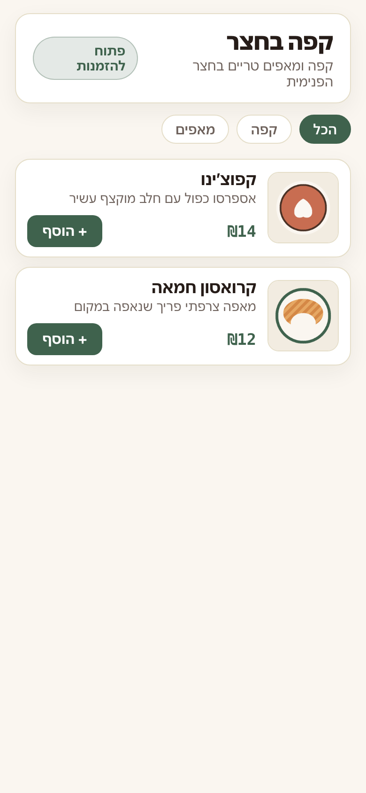

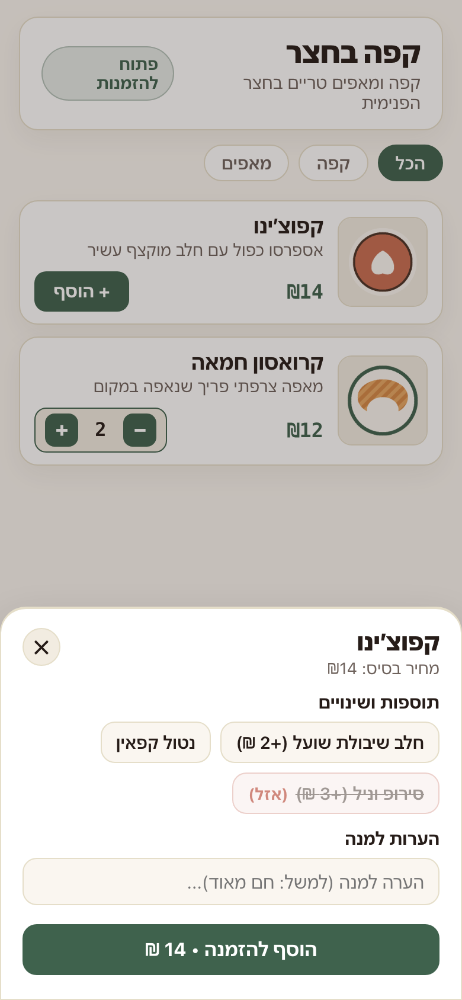

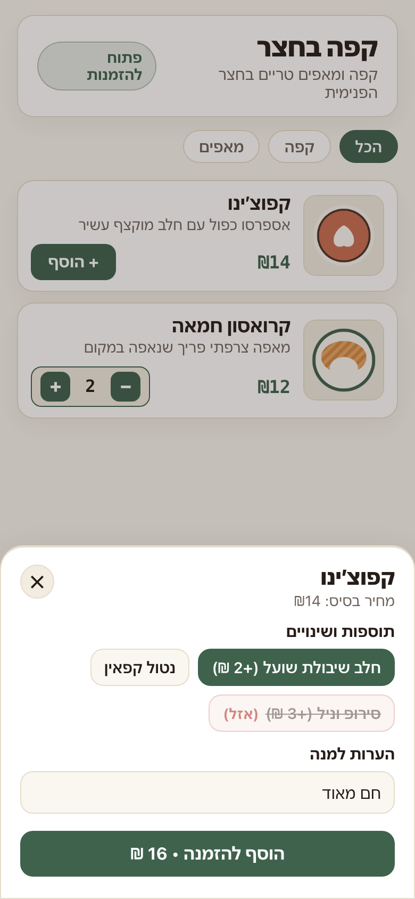

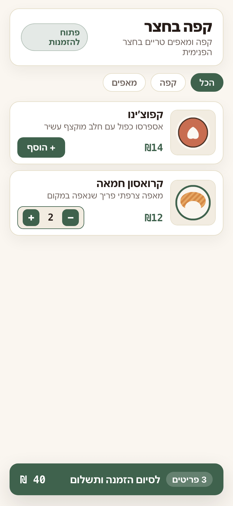

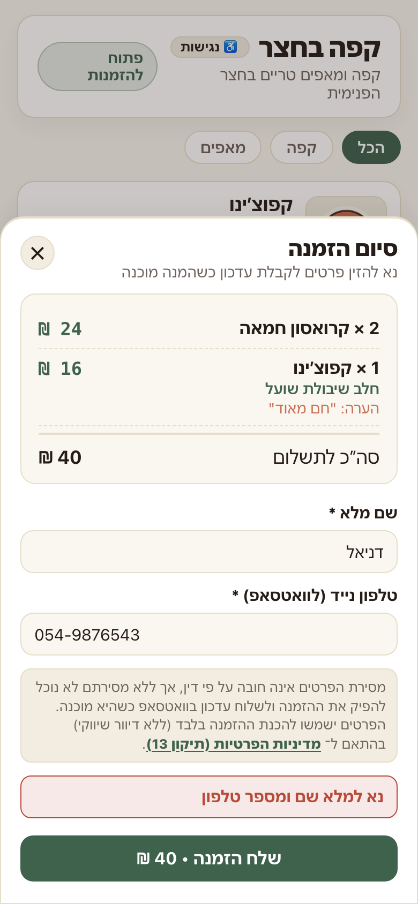

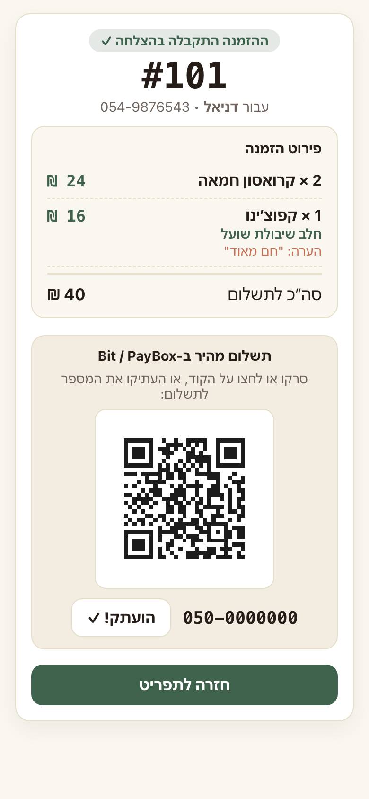

---

### C. Milestone 3 (`CUJ-04` – `CUJ-06`): Admin 4-Digit PIN Gate & Barista KDS (`/admin/kds` → `/`)

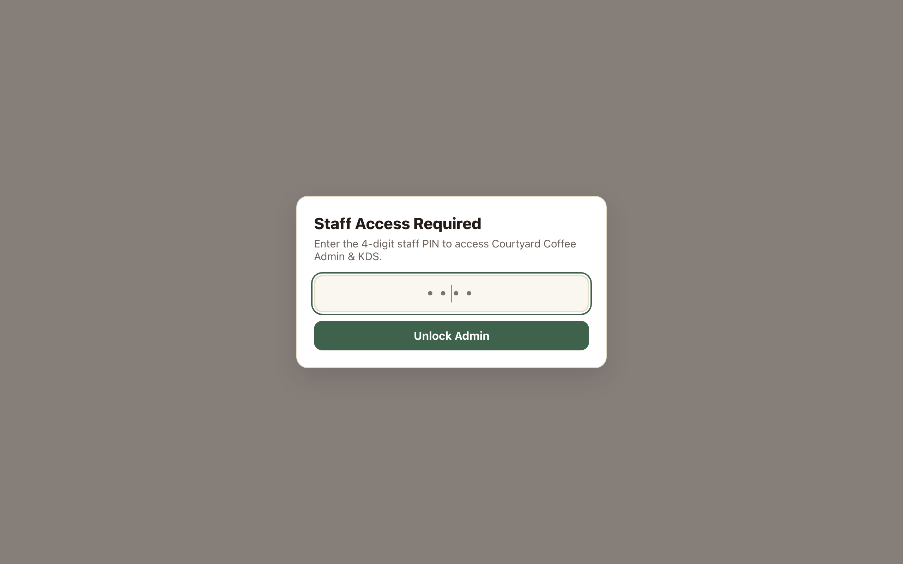

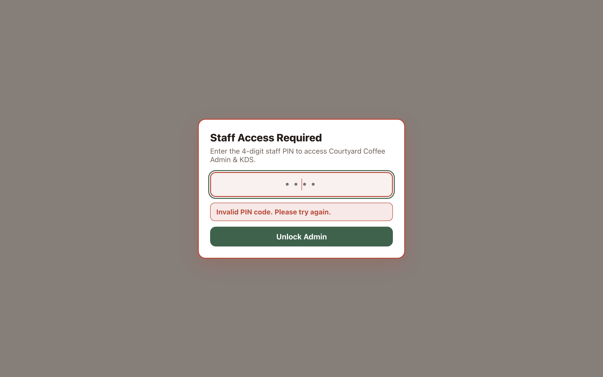

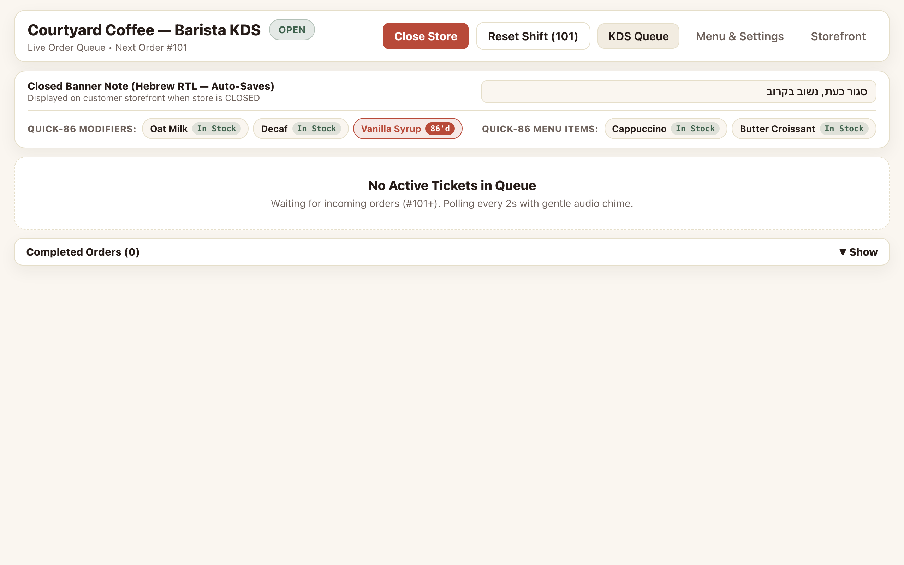

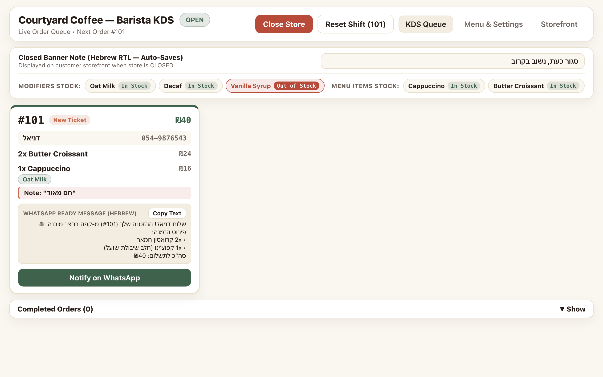

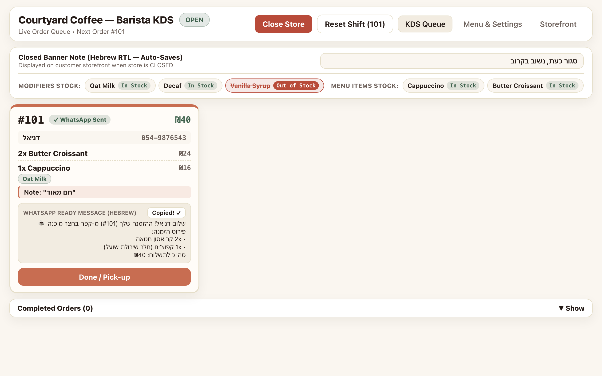

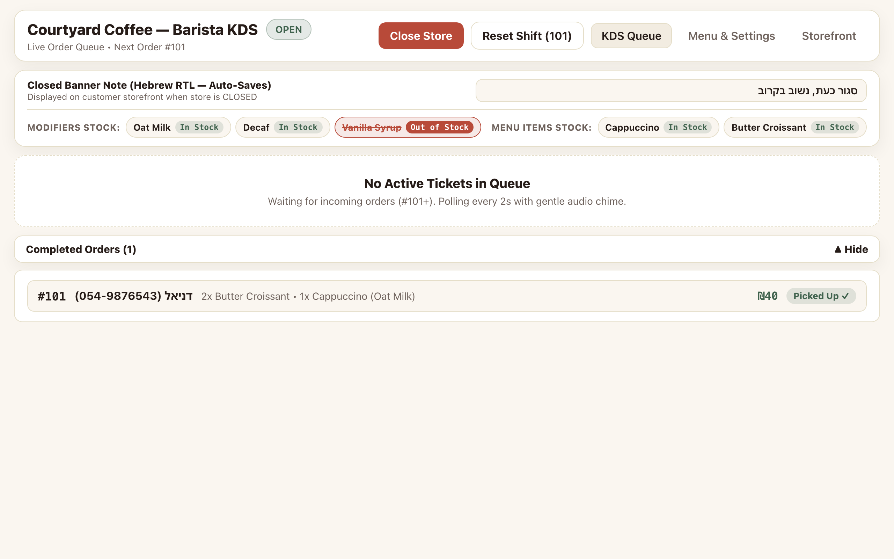

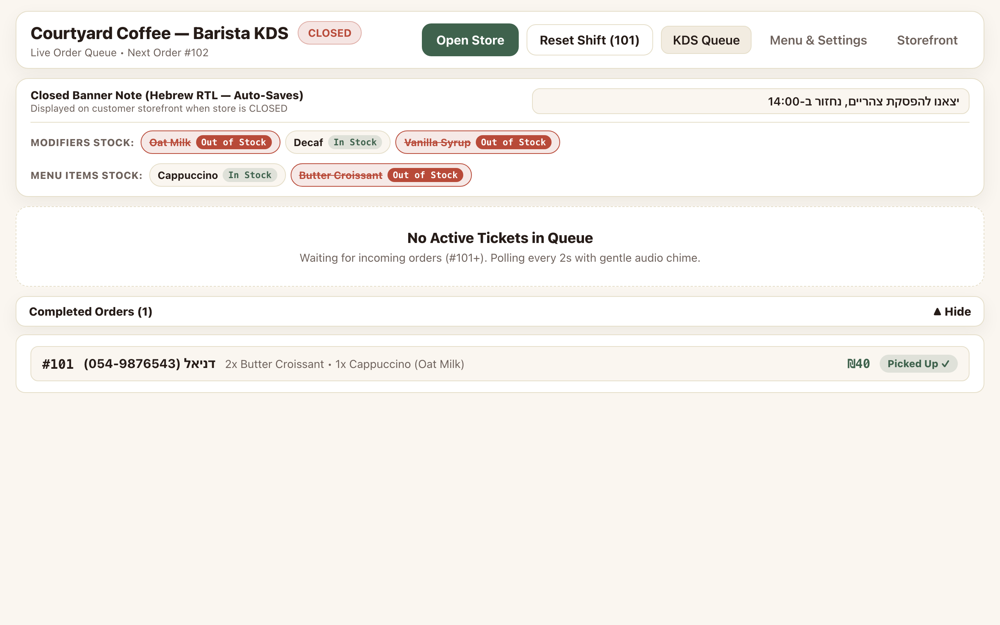

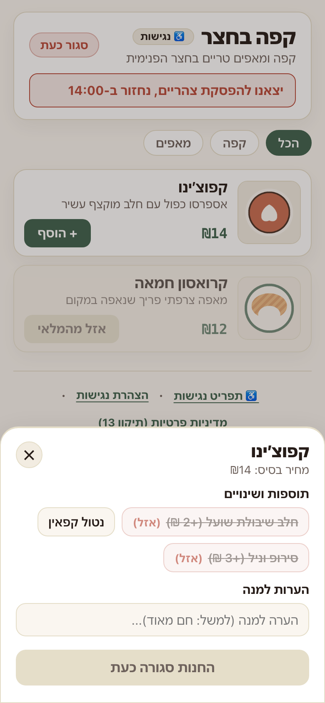

---

## 2. Red → Green Git Tag Matrix (`m1-red` – `m4-green`)

| Tag | Commit SHA | Test Suite Status | Description |
| :--- | :--- | :--- | :--- |
| `m1-red` | `32edca1455b179c30e9ef29db32ef635fba4034f` | `8 failed, 0 passed` | Failing M1 assertions against unimplemented stubs |
| `m1-green` | `de8c9403e5438b3c76a5d459b75dc379f76510c0` | `8 passed, 0 failed` | M1 SQLite schema, seed, ISO-18004 QR, WA builder, and SPA shells |
| `m2-red` | `d15c40a6a514cc4c1a2bbc6a989446370e249760` | `3 failed, 8 passed` | Failing M2 assertions for `CUJ-01`, `CUJ-02`, `CUJ-03` |
| `m2-green` | `602084b4bd171d2a4fc3f4c2eafb4e09629edd54` | `11 passed, 0 failed` | Full Customer Storefront, `TagBottomSheet`, `CheckoutSheet`, `StaticReceipt` |
| `m3-red` | `bc1da9336de1c5a3f16bd0fa4f787bd67c6df235` | `4 failed, 11 passed` | Failing M3 assertions for `CUJ-04`, `CUJ-05`, `CUJ-06` |
| `m3-green` | `2199d781fda4b2b4f5f2098cb2d0f244f25d9bd7` | `15 passed, 0 failed` | `PinGateModal`, Barista KDS `2000ms` polling, chime, 2-tap lifecycle, Quick-86 |
| `m4-red` | `fc2be6f201426e9811b542c8ee301310f4220135` | `2 failed, 15 passed` | Failing M4 assertions for `CUJ-07` admin spreadsheet & photo album |
| `m4-green` | `0d0850a2f85972d71883cd5da2394df5ea49d5a3` | `17 passed, 0 failed` | Full `/admin/menu` spreadsheet, `400×400` JPEG compressor, runtime delete proofs, 7-CUJ CDP suite, `README.md` |
